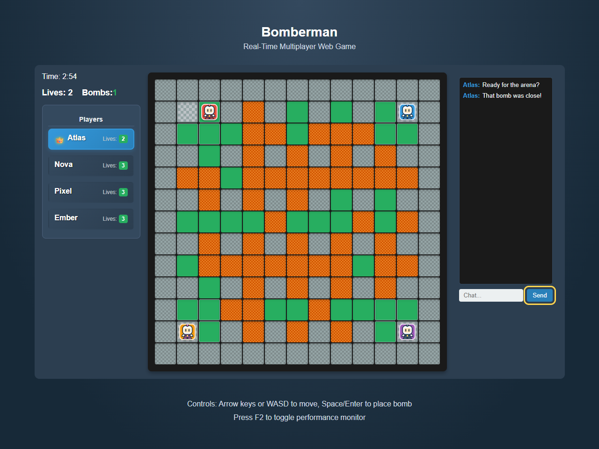

# Bomberman: Real-Time Multiplayer Web Game

A Bomberman-inspired browser game for **2–4 players**, built with vanilla JavaScript, a custom DOM framework, and a Node.js WebSocket server. Players share one arena, destroy blocks, collect power-ups, and compete to be the last survivor. Lobby and in-game chat keep everyone connected.



## Features

- A randomized 13 × 13 arena with indestructible walls, destructible blocks, and protected corner spawns.
- A lobby with unique nicknames, live player counts, and chat.
- A 20-second waiting period after the second player joins, followed by a 10-second countdown. Four players skip directly to the countdown; dropping below two cancels it.
- Three lives per player, three-second bomb fuses, chain reactions, and server-validated collision detection.
- Bomb-capacity, explosion-range, and movement-speed power-ups, with a 35% drop chance from destroyed blocks.
- Three-minute rounds. The last survivor wins; at the time limit, remaining lives decide the winner, with ties recorded as draws.
- Spectating and chat after elimination, results, and a fresh lobby after each round.
- Selective DOM updates, a `requestAnimationFrame` loop, and an optional performance panel.
- Original SVG player sprites, keyboard focus indicators, reduced-motion support, and responsive layouts.

## Run locally

Use **Node.js 22 or later** and npm. There is no build step or database.

```sh
npm ci
npm start
```

Open **http://localhost:9090** in two to four browser tabs or separate browsers. Give each player a different nickname. To play across devices on the same network, open the host computer's network address with port 9090 and allow the connection through its firewall.

```sh
npm run dev     # Restart the Node server when source files change
```

On Windows, use `npm.cmd` if PowerShell blocks the `npm.ps1` launcher.

| Action            | Control                               |
| ----------------- | ------------------------------------- |
| Move              | Arrow keys or WASD                    |
| Place a bomb      | Space or Enter                        |
| Send chat         | Enter while the chat input is focused |
| Performance panel | F2                                    |

The game is designed for a keyboard. Smaller screens can display the lobby and arena; touch controls are not implemented.

## Architecture

```text
server.cjs                    HTTP serving, configuration, and shutdown
src/backend/GameServer.js     Authoritative game rules and round lifecycle
src/backend/websocketServer.cjs  WebSocket sessions, validation, and broadcasting
src/shared/                   Game constants and shared collision validation
src/app/                      Game UI, controls, chat, and selective map rendering
src/framework/                Custom state, event, routing, and rendering modules
assets/                       Original SVG player sprites
```

The server owns positions, lives, bomb capacity, power-ups, movement timing, and match outcomes. Clients send actions rather than trusted coordinates. Shared collision validation gives immediate client feedback while the server independently validates every move.

The server processes game logic every 100 ms, using wall-clock deadlines for bomb fuses and the round timer. Browser rendering runs separately through `requestAnimationFrame`; the server tick rate is not a claim about display FPS. State snapshots contain game data, while timer handles remain private.

The client framework uses real DOM elements, batched state notifications, delegated events, and cached map cells. It does **not** implement Virtual DOM diffing. See [framework.md](framework.md) for the implemented API.

## License

[ISC](LICENSE). This is an independent educational project. Player artwork in `assets/` is original SVG artwork included with the project.
